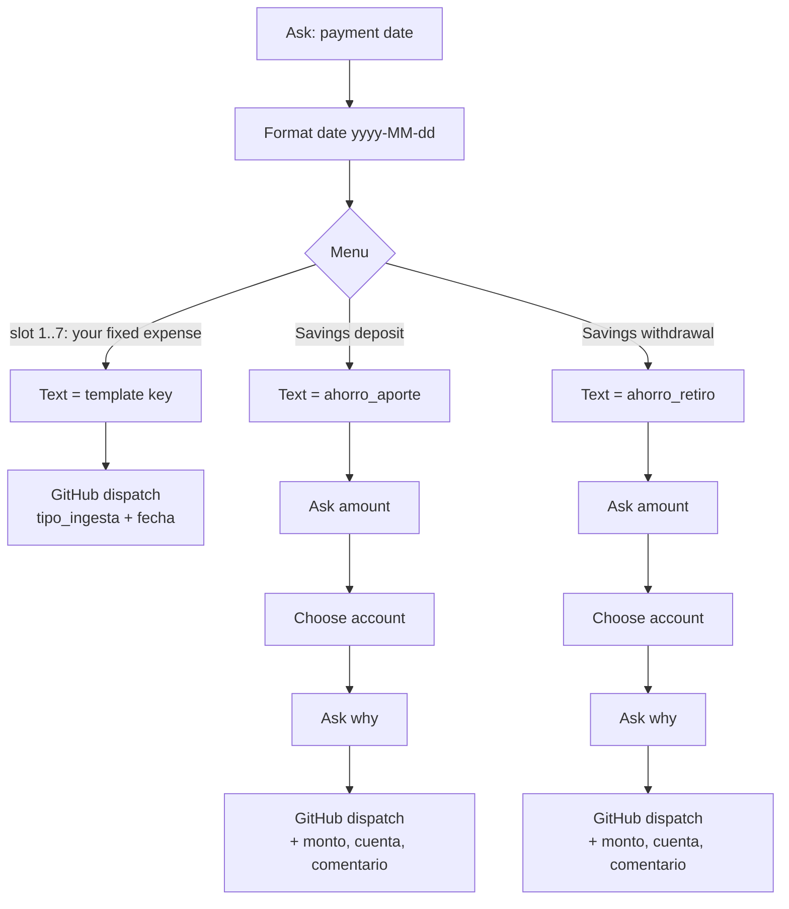
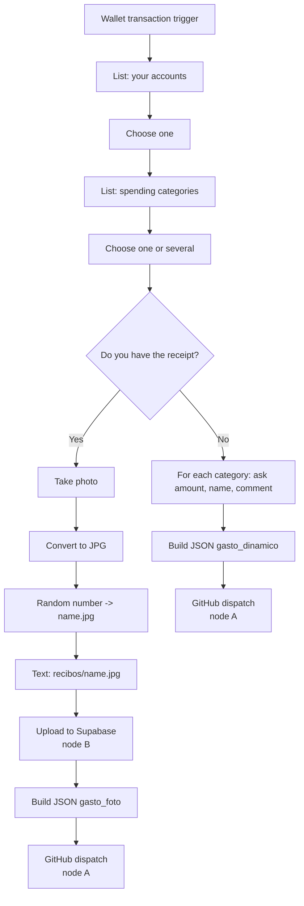
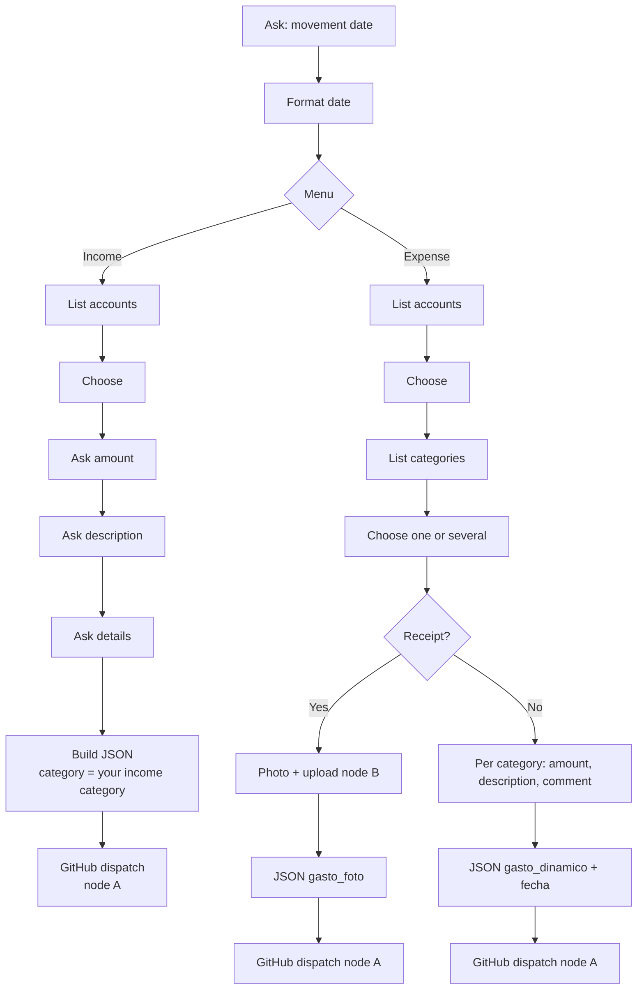

# Shortcuts guide — what each one does and exactly what to fill in

Three Shortcuts feed the system. You duplicate them from the links below, fill the blanks (`completar` / `complete` in the Shortcut, `{{PLACEHOLDER}}` in the JSON files of this repo) and you are done. The Phase 0 interview generates a `MIS_ATAJOS.md` with **your** values for every blank, node by node; this page explains the blanks.

| # | Shortcut | Use it to | Starts from | Link |
|---|---|---|---|---|
| 1 | **Gasto_fijo** (fixed expenses) | log rent, subscriptions, phone… with one tap, plus savings deposits/withdrawals | you, manually (or a time automation) | `<ICLOUD_LINK_GASTO_FIJO>` |
| 2 | **Compras** (purchases) | log a purchase right when you pay with a Wallet card / NFC | Wallet transaction automation | `<ICLOUD_LINK_COMPRAS>` |
| 3 | **Manufinanza** (manual hub) | log any income or expense by hand, with or without receipt photo | you, manually | `<ICLOUD_LINK_MANUFINANZA>` |

JSON exports of the exact node sequence live in [`shortcuts/`](../shortcuts) (documentation only: you duplicate the iCloud links, you do not import these).

---

## The two nodes that appear everywhere

### A. "Get contents of URL" that talks to GitHub (every Shortcut, every branch)
This is the node that sends the expense to your repository. It is the **same configuration** every time:

| Field | Value |
|---|---|
| URL | `https://api.github.com/repos/<GITHUB_OWNER>/<GITHUB_REPO>/dispatches` |
| Method | `POST` |
| Header `Authorization` | `Bearer <GITHUB_PAT>` (the word `Bearer`, one space, your token) |
| Header `Accept` | `application/vnd.github+json` |
| Request body | JSON, already built by the previous nodes — do not touch |

`<GITHUB_PAT>` is a fine-grained token limited to your private repo with *Contents: Read and write* ([SECRETS.md](SECRETS.md)).

### B. "Get contents of URL" that uploads the receipt photo (Compras and Manufinanza, branch "Sí")
| Field | Value |
|---|---|
| URL | `https://<SUPABASE_PROJECT_REF>.supabase.co/storage/v1/object/` **followed by the variable `Text`** (the text node that holds `recibos/<number>.jpg`) |
| Method | `POST` |
| Request body | File → the converted image variable |
| Header `apikey` | `<SUPABASE_PUBLISHABLE_KEY>` |
| Header `Authorization` | `Bearer <SUPABASE_PUBLISHABLE_KEY>` |
| Header `Content-Type` | `image/jpeg` |

The publishable key can only INSERT into the private `recibos` bucket (policy `recibos_anon_insert_only`); it cannot read or list.

---

## 1. Gasto_fijo — fixed expenses

### Rule of this Shortcut
A *fixed* expense has a **fixed amount and a fixed paying account**. Both live in your `config/plantillas_estandarizadas.json` (Phase 0 writes it), so the Shortcut asks nothing about money: it only sends **which expense** and **which date**. Anything whose amount changes (a variable phone bill, groceries) is logged with Manufinanza instead.

### Menu slots (the first 6-7 options)
Each slot has **two** blanks that you fill from the Phase 0 summary:

| Blank | Where | What to write | Example |
|---|---|---|---|
| Menu option label | the option title in the Menu node | free text, what you want to read | `Rent` |
| Text node content | the Text node inside that option | the **exact template key** (case-sensitive, no spaces; use `snake_case`) | `rent` |

Everything after the Text node (the GitHub dispatch node, node A) is identical across slots; only the GitHub URL and token need to be set once (copy the node to the other slots).

Need more slots? Duplicate a slot (long-press → Duplicate), change the label and the Text. Fewer? Delete the slot. The key you type must exist as a top-level key in `plantillas_estandarizadas.json` — if it does not, you get a ❌ Telegram message saying `tipo_ingesta '...' does not exist`.

### Savings deposit / withdrawal (keep as they are)
These two are **structural**: the system needs exactly these keys, `ahorro_aporte` and `ahorro_retiro`. The only blanks are the account lists:

| Blank | What to write |
|---|---|
| `Lista` node "choose account" | the accounts you move money **from** (deposit) or **to** (withdrawal): exact `cuentas.nombre_cuenta` values, e.g. `Main bank`, `Cash`. The savings account itself is fixed in the template. |

### Checklist
- [ ] 6-7 slots: label + template key each
- [ ] Savings lists contain your real account names
- [ ] GitHub URL and `Bearer` token set in every dispatch node

---

## 2. Compras — automation fired when you pay (NFC / Wallet)

| Blank | Node | What to write |
|---|---|---|
| Trigger | automation settings | the Wallet cards that should fire it |
| Account list (2 shown, add as many as you need) | first `Lista` | exact account names, e.g. `Main bank`, `Credit card` |
| Category list (4 shown, add as many as you need) | second `Lista` | category **codes** (`codigo_categoria`), e.g. `alimentacion`, `transporte` |
| Upload node B (branch Yes) | `Get contents of URL` | URL, `apikey`, `Authorization` as in node B |
| Dispatch node A (both branches) | `Get contents of URL` | URL and `Authorization` as in node A |

How it records: with a photo, a vision model reads the receipt and labels each product (you only pick categories); without a photo, you type amount/name/comment per selected category and a keyword matcher picks the label. Date = the moment it fires.

---

## 3. Manufinanza — manual hub (income and expense)

| Blank | Node | What to write |
|---|---|---|
| Income account list | first `Lista` (branch Income) | accounts that can receive money (not credit cards) |
| Income category | the `Texto` node right after "description" | the **code** of your catch-all income category (default `ingresos_varios`); it must exist in `categorias` with type `ingreso` |
| Expense account list | `Lista` (branch Expense) | accounts + credit cards you pay with |
| Expense category list (any number) | second `Lista` | category codes |
| Upload node B | branch Yes | URL, `apikey`, `Authorization` |
| Dispatch node A | the three HTTP nodes at the end | URL and `Authorization` |

Important: **keep the date inside the payload at the top level** (`"fecha"` next to `"cuenta"`), as the JSON in this repo does; a date placed inside each line is ignored by older versions of the script.

---

## Common mistakes
| Symptom | Cause |
|---|---|
| ❌ `No account named '...'` | list item differs from `cuentas.nombre_cuenta` (case, spaces) |
| ❌ `No valid version of category '...'` | category code does not exist or is not valid on that date |
| ❌ `tipo_ingesta '...' does not exist` | the Text node key is not a key of `plantillas_estandarizadas.json` |
| Nothing arrives, no Telegram | token expired / wrong repo name / missing `Bearer ` prefix (HTTP 401/404 in the Shortcut result) |
| Photo flow ❌ after upload | URL of node B missing the variable `Text`, or bucket path not `recibos/<name>.jpg` |
